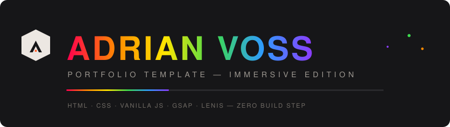
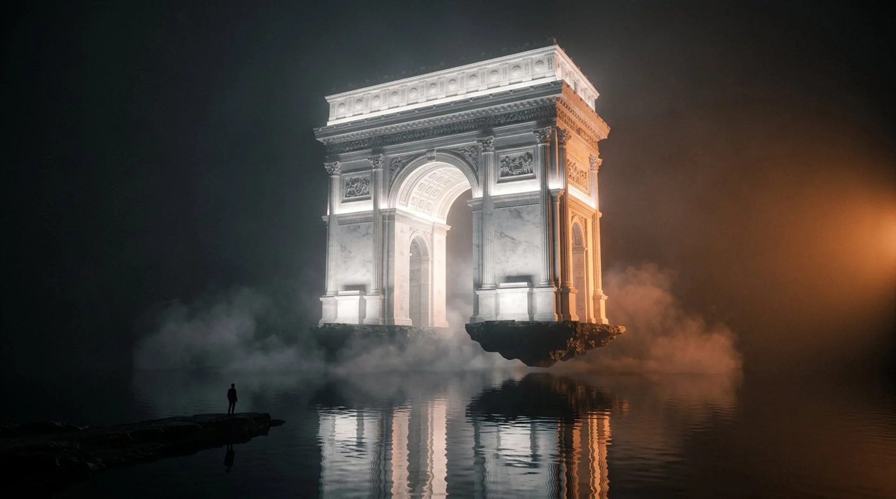
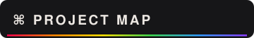
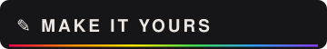

<div align="center">




<br/>


**An immersive, award-style personal portfolio — dark, cinematic, buttery-smooth.**
No frameworks. No build step. Drop it on GitHub Pages and it's live.

[Live demo](#-live-preview) · [Getting started](#-getting-started) · [Make it yours](#-make-it-yours) · [Deploy](#-deploy-on-github)

</div>


<picture>
  
</picture>

<br/>


- **Cinematic preloader** — spinning mark + real page-gating, then a choreographed hand-off into the hero
- **Fullscreen level-select menu** — three tiles with hover image-swaps, staggered entrances, ESC to close
- **Hero slideshow** — full-bleed crossfading imagery with slow Ken-Burns drift every 4s
- **Masked-line typography** — every headline rises out of its own mask, timed to the scroll
- **Silk smooth scrolling** — Lenis + GSAP ScrollTrigger driving parallax backdrops and settle-zoom imagery
- **Self-drawing skill tree** — SVG branches draw themselves as you scroll, nodes pop in behind them
- **Hover-flood discipline list** — ink rolls up each row on contact
- **Client wall** — 21 entries cascading in, wrapped in a warm corner glow
- **Signature footer** — huge stacked type, skew-sweep CTA button, social rail
- **Page veil transitions** — internal navigation wipes in/out instead of blinking
- **Sound page with equalizer track list** — tap a track, the bars dance
- **Ambient video loops** — three seamless H.264 Ken Burns reels woven into the inner pages
- **Custom cursor** that flips light/dark with the section under your pointer
- **Film grain overlay**, hidden scrollbar, orange accent selection — the details are the design
- **Fully responsive** (no separate mobile site) + `prefers-reduced-motion` respected
- **64 files, ~6 MB total** — every asset local, nothing external but your ambition

<br/>


| Layer     | Choice                                   | Why                                              |
| --------- | ---------------------------------------- | ------------------------------------------------ |
| Markup    | Hand-written **HTML5**                   | Semantic, fast, zero framework tax               |
| Styling   | **CSS3** custom properties               | One token file controls the whole mood           |
| Motion    | **GSAP 3.12 + ScrollTrigger** (vendored) | Industry-standard timeline control               |
| Scrolling | **Lenis 1.3** (vendored)                 | Butter, with inertia you can tune                |
| Type      | **Archivo variable (100–900)**           | One 34 KB woff2, every weight you'll need        |
| Images    | **WebP**, self-hosted                    | ~3 MB of imagery, lazy-loaded                    |
| Video     | **H.264 MP4 loops**                      | 3 seamless ambient reels, muted + `playsinline`  |
| Icons     | Inline **SVG**                           | No icon-font bloat, recolors with `currentColor` |

> Everything in `js/vendor/` is pinned and local — the site works offline and never phones a CDN.

<br/>



```
portfolio/
├── index.html            # Home — hero, intro, about, skills, achievements, footer
├── works.html            # World 01 — Brands (grid + showcase rows)
├── games.html            # World 02 — Games
├── sound.html            # World 03 — Sound (equalizer track list)
├── 404.html              # Lost-between-worlds page
├── css/
│   ├── fonts.css         # Archivo @font-face + type tokens
│   ├── style.css         # Design system + home page
│   ├── menu.css          # Overlay menu, toggle, page veil
│   └── pages.css         # Inner-page modules
├── js/
│   ├── main.js           # Preloader, menu, veil, Lenis, reveals, sliders
│   ├── pages.js          # Grid wipes, rows, track player demo
│   └── vendor/           # gsap · ScrollTrigger · lenis (pinned, local)
├── cursor/               # Custom cursors (light/dark + hover states)
├── fonts/                # archivo-var-latin.woff2
├── img/                  # favicon + final WebP artwork (heroes, covers, grids)
├── video/                # reel_*.mp4 — seamless ambient loops (H.264, 720p)
├── assets/readme/        # Animated SVG banners for this README
├── LICENSE               # MIT
└── README.md
```

<br/>


No install. No build. Pick one:

**1. Double-click** — open `index.html` in any modern browser. That's it.

**2. Local server** (best for correct font/image loading):

```bash
# Python (preinstalled almost everywhere)
python -m http.server 8080

# or Node
npx serve .

# or VS Code → extension "Live Server" → right-click index.html → Open with Live Server
```

Then visit **http://localhost:8080**

<br/>



Every placeholder is deliberately easy to find:

| You want to change…       | Where                                                                              |
| ------------------------- | ---------------------------------------------------------------------------------- |
| Name, role, email, phone  | Search `Adrian Voss`, `hello@adrianvoss.studio`, `+33 7 00…` across the HTML files |
| Hero / menu / grid images | Replace files in `img/final/` (keep the same names and it just works™)             |
| Ambient videos            | Replace files in `video/` — 1280×720 H.264 loops work best (keep names)            |
| Client list               | `.clients` block in `index.html` — 3 columns × 7 rows                              |
| Colors                    | `:root` in `css/style.css` — `--paper`, `--ink`, `--accent`                        |
| Cursors                   | Drop new 32×32 PNGs into `cursor/`, keep filenames                                 |
| Slideshow speed           | `data-slideshow="4000"` (ms) on the hero                                           |
| Scroll feel               | `duration: 1.15` in `js/main.js` (Lenis options)                                   |
| Your sound tracks         | Drop `.mp3` in an `audio/` folder and bind them in `js/pages.js`                   |
| Social links              | Search `href="#"` inside `.social-rail` blocks                                     |

<br/>


https://Muhammad112233-creator.github.io/Portfolio-Template-26/

### Accessibility & performance

- Respects `prefers-reduced-motion` — animations settle instantly for sensitive users
- Semantic landmarks, `aria-expanded` on the menu, focusable track rows, real `alt` text
- No jQuery, no frameworks, no web-font round trips — first paint is the preloader, by design

### License

**MIT** — see [`LICENSE`](LICENSE). Rename the persona, ship it as your own, credit optional (but appreciated). Imagery and video loops shipped in `img/final/` and `video/` are original AI-generated artwork made for this template — swap in your own craft when ready.

<div align="center">


<div align="center">

## 🌟 Support the Project

If you find this template useful, please consider giving it a star! It helps others discover the repository and supports future development.

</div>


Made with obsession, and no page builders were harmed.

</div>
